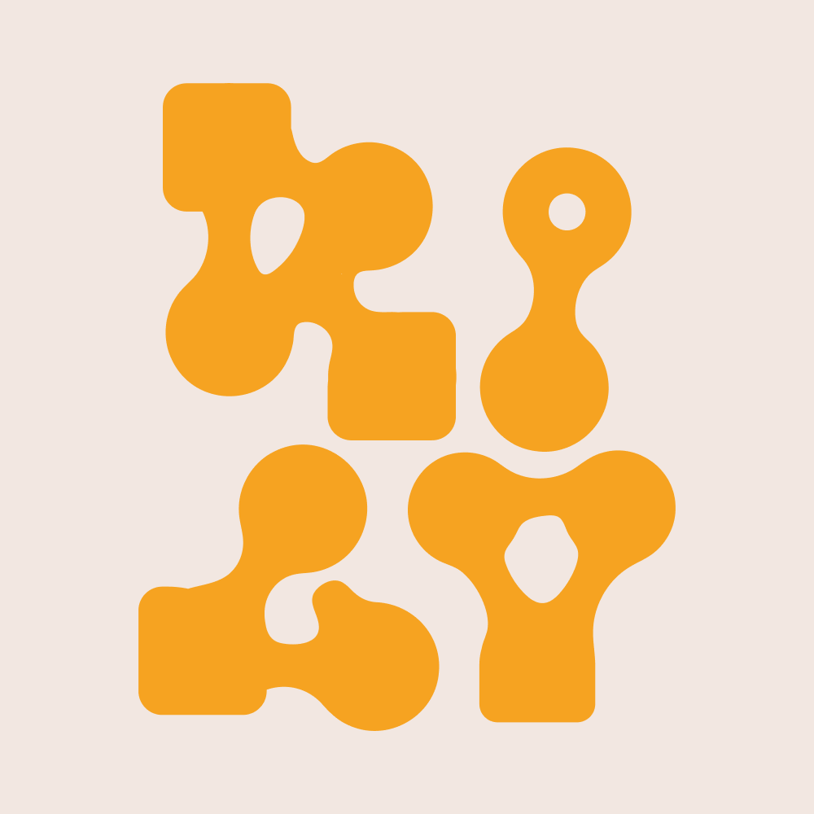

# Rigo — multimodal longitudinal observatory

**Platanus Hack 26 · Santiago ft. Buk · Track: 🔧 Hardware · team-21**

Scientific instrumentation that turns real-world observations into **standardized, traceable and verifiable longitudinal measurements**, reducing the exclusive reliance on self-report in human behavior research.

## The problem

Longitudinal studies in nutrition, rehabilitation, psychology and occupational health rely mostly on self-report and sporadic observation: recall bias, under/over-reporting, inter-rater variability, low temporal resolution, missing context and, crucially, no way to tell *"it didn't happen"* from *"it wasn't observed"*.

## The solution

1. **Wearable pendant**: camera, microphone, environmental sensors (temperature, humidity, sound level, gases), RTC, battery, buzzer and physical privacy controls.
2. **Android app**: the participant pairs the device, sees its status, reviews and excludes footage **before** anything is uploaded.
3. **Backend + AI pipeline**: an agent selects and cuts only the study-relevant segments of authentic footage, then a multimodal model extracts structured, protocol-defined variables linked to their source evidence.
4. **Researcher portal**: versioned observation protocols, timelines, coverage and uncertainty, evidence review and CSV/JSON export for longitudinal analysis.

The output isn't a summary like *"ate 3 times today"*. It's a measurement: *"3 eating episodes detected, 82% of the target window observed, evidence linked per episode, protocol `eating-v1`, model `x`"*.

**Demo vertical:** detection of eating episodes (timing, frequency, duration, observable context). We do **not** estimate calories.

## Repository layout

| Path | What | Owner |
|---|---|---|
| `hardware/` | Wiring, BOM, enclosure (3D) | Alendi |
| `firmware/` | ESP32-CAM + Arduino sensor hub | Alendi |
| `android/` | Participant app (Kotlin) | Mauri |
| `web/` | Next.js app: API + researcher portal | Pedro, Mauri |
| `db/` | Shared Postgres schema and migrations (Drizzle) | Pedro, Mauri |
| `worker/` | Background jobs: video agent (selection + extraction) | Pedro, Pablo |
| `data/` | Schemas, sample data, annotations, evaluation | Pablo |
| `docs/` | Problem, pitch, protocols, decisions | Mari |

See [`AGENTS.md`](./AGENTS.md) for architecture, contracts and conventions, and [`DEVELOPMENT.md`](./DEVELOPMENT.md) for local setup.

## Team

- Mariana Paz Vásquez Barrios ([@mari-vasquez98](https://github.com/mari-vasquez98))
- Mauricio Andrés Villa Bravo ([@heismauri](https://github.com/heismauri))
- Pablo Sebastian Bahamondes Walters ([@pablosbw](https://github.com/pablosbw))
- Alendi Brandtii Balbontín Nuñez ([@imbalbontin](https://github.com/imbalbontin))
- Pedro Ignacio Bahamondes Walters ([@pibahamondesw](https://github.com/pibahamondesw))

## Submission checklist

- [ ] Project metadata (name, oneliner, description, deploy URL) in `platanus-hack-project.jsonc`
- [ ] Project description in `project-description.md`
- [x] 1000x1000 PNG logo, max 500 KB
- [ ] Concise README
